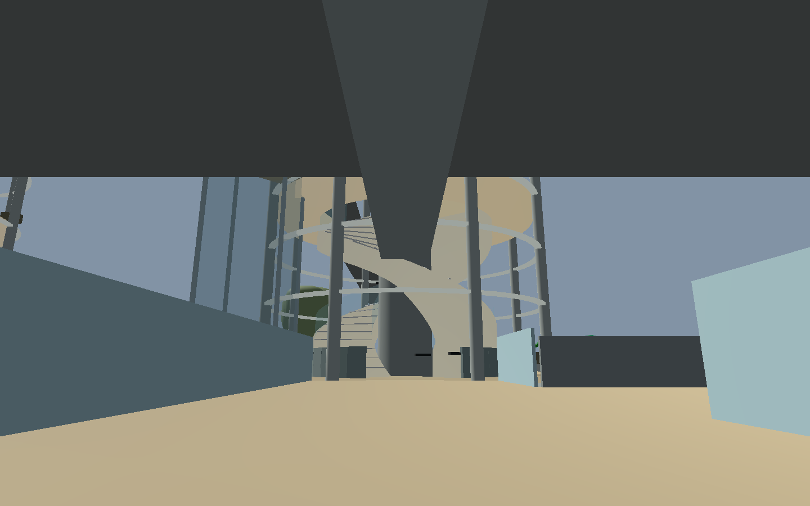
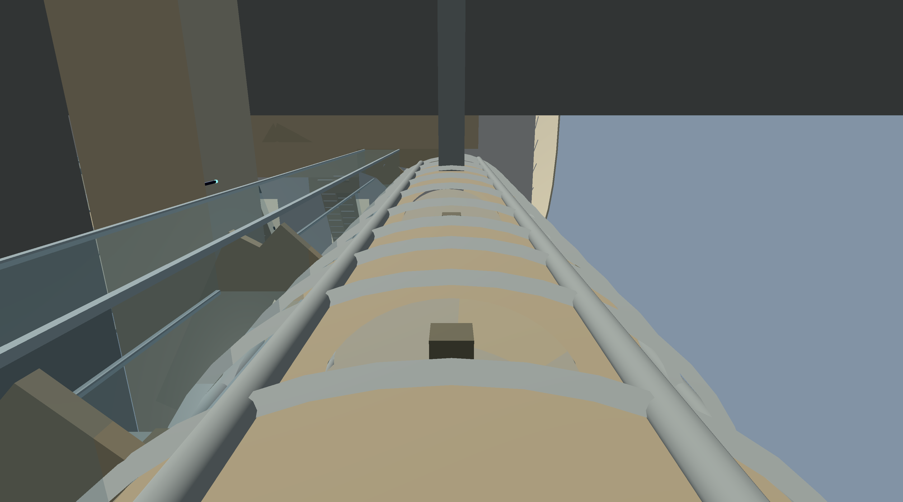
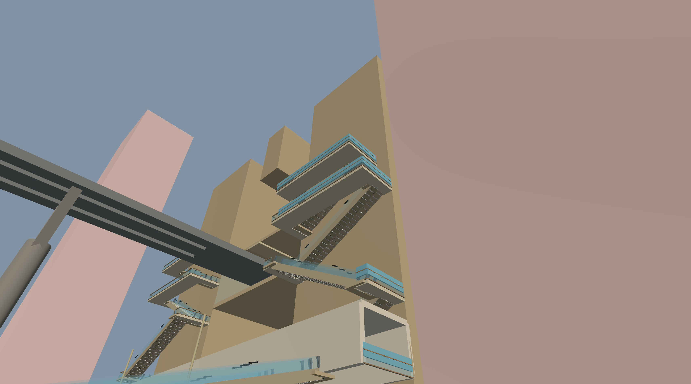
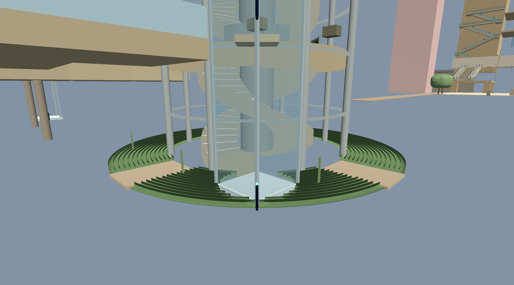

# Moy P1 fixes, third review

2026-10-19. Package P1, section 6 of `docs/architecture/moy_prototype_pass_4.md`.

## Fixes

1. **Gallery edge clearance.** The 48-sided gallery ring now starts at a vertex radius of `4.02 / cos(π/48)`, keeping each chord at or beyond r=4.02. Inner-rail boxes moved to r=4.1, leaving their full 0.12 m thickness outside the helix band. Rails still open at the hand landings and at the plan's way-out bearings.
2. **Ground clearance.** Park paving is cut around each tower drum through r=6.0. The lawn surface is now +0.04 m, within 0.01 m of the way-out floor's +0.05 m lower limit, so it clears both headroom and way-out volumes.
3. **Rain gardens.** Each is built as the plan's ring from `r_in` to `r`, with 2.4 m path corridors cut along its three lawn way-out bearings and the specified lift-clear zone. Matching paved paths run from the drum to the ring's outer edge. The plan's reeds remain outside the paths and lift clearance.
4. **Way-out bays.** Inner gallery rails leave bays for the new authored ways-out. The updated plan supplies the bay bearings and the climbing panels already avoid them.
5. **Way-out volume.** The validator now tests r=4.2–7.0, 2.4 m wide and 2.8 m high, from floor +0.05 m.
6. **Collider-kind reporting.** Band and way-out results now report unique colliders grouped by kind; the validator does not exempt any new collider classes.

## Checks

Before these geometry fixes, on the updated plan and previous bake, the focused validator reported:

```text
MOY_P1_SUBSET packs=62 bodies=1225 nodes=8281
MOY_P1_HEAD_BEAMS checked=4 failures=0 span_m=14.8 ends_m=+/-7.4
MOY_P1_HELIX_BAND towers_with_hits=4 hit_samples=897 unique_non_hand_colliders=304 volume_samples=2505
MOY_P1_WAYS_OUT checked=28 hit_samples=42 blocked_boxes=26
MOY_CITY_HALL_GALLERIES checked=14 failures=0
MOY_P1_SUBSET_RESULT failures=30
```

The band hits were the gallery inner rails and ring chords, plus park paving and the full-disc rain gardens at the helix feet. Way-out boxes hit gallery rails, rain gardens and lift/ground geometry.

After rebuilding, `python3 tools/check_moy_bake.py` reports:

```text
Moy city bake current: 198 packs; {'buildings': 47, 'lots': 133, 'old_houses': 60, 'streets': 22}
```

The focused validator finishes on the 62 Crossing and civic-core packs:

```text
MOY_P1_SUBSET packs=62 bodies=1181 nodes=8153
MOY_P1_HEAD_BEAMS checked=4 failures=0 span_m=14.8 ends_m=+/-7.4
MOY_P1_HELIX_BAND towers_with_hits=0 hit_samples=0 unique_non_hand_colliders=0 collider_kinds=[] volume_samples=2505
MOY_P1_WAYS_OUT checked=28 hit_samples=0 blocked_boxes=0 unique_colliders=0 collider_kinds=[] r=4.2..7.0 width=2.4 height=2.8
MOY_CITY_HALL_GALLERIES checked=14 failures=0
MOY_P1_SUBSET_RESULT failures=0
```

The plan check `python3 tools/city_layout.py` completed. Its generator rewrote three long generated constant lines in `scripts/city_plan.gd` on this machine; I restored that generated file to its committed content and left it unchanged. The generated plan still contains the reviewed r=6.0/9.5 rain gardens, paths, lift clearances, and seven ways out per tower.

## Screenshots









The four images were rendered from the focused pack scenes after the passing check. The full streamed runtime was not part of this P1-only run; its earlier terrain/pack streaming crash remains recorded under the P2 performance/streaming handoff.
