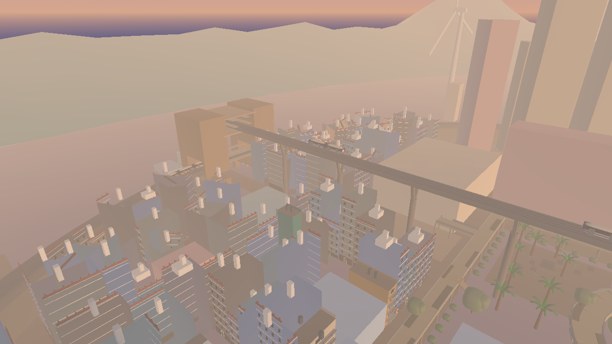
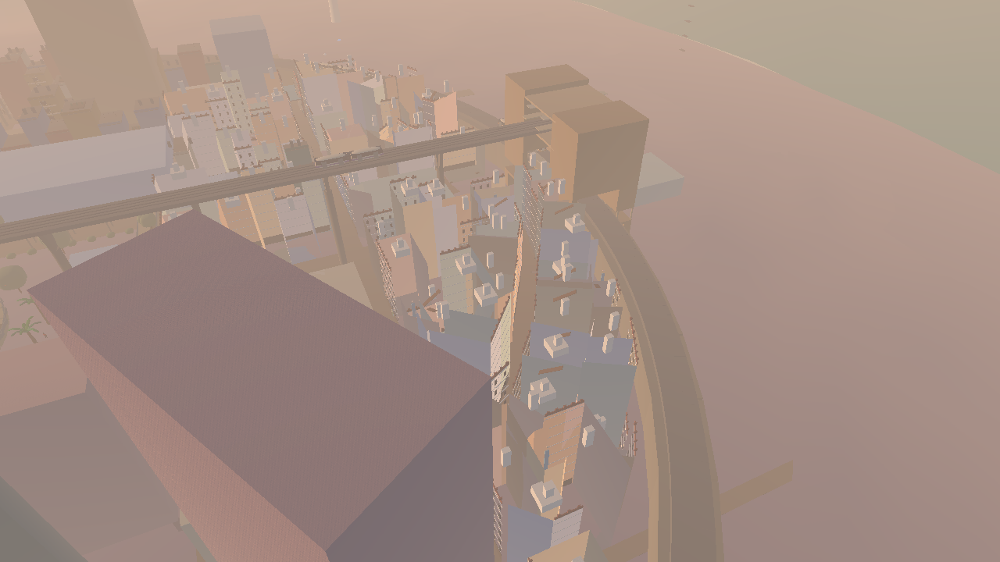
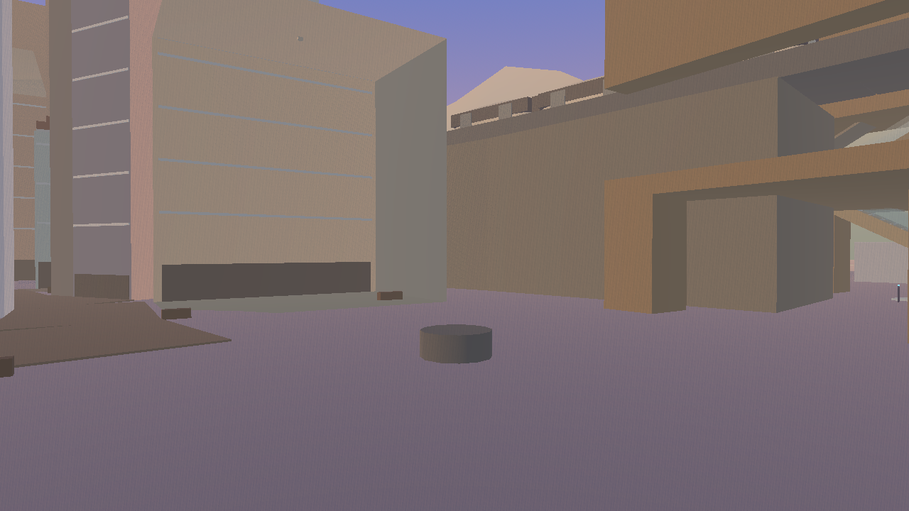
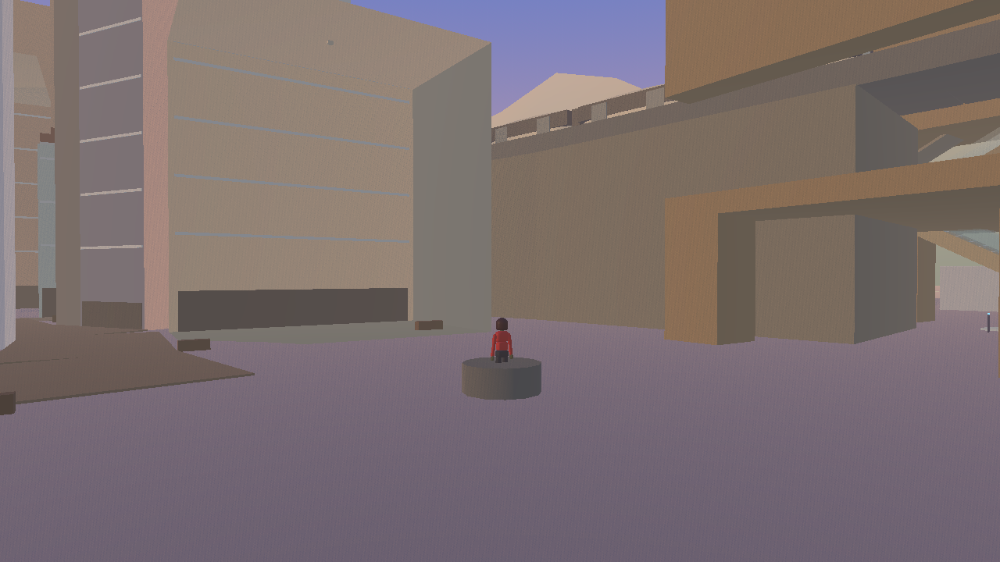
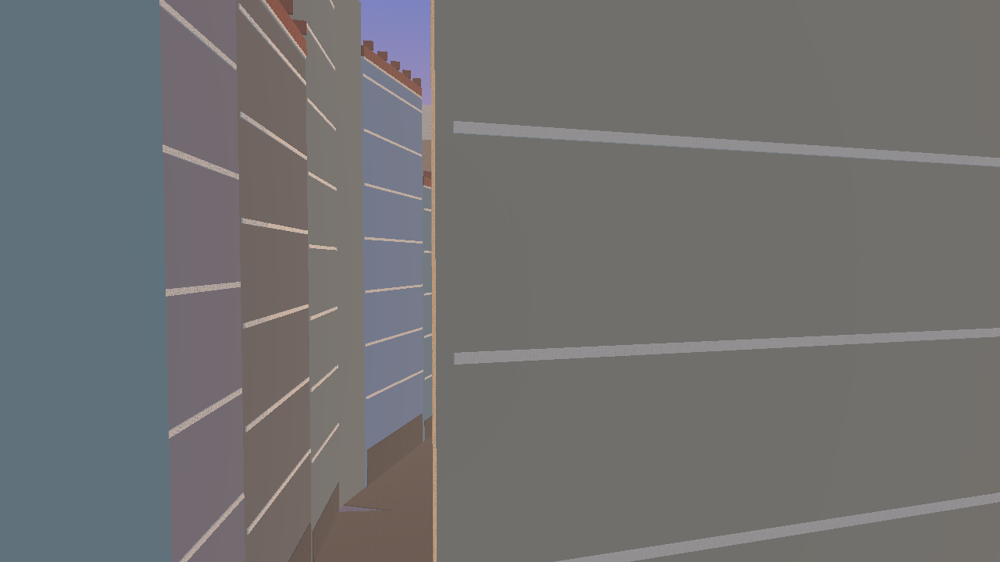
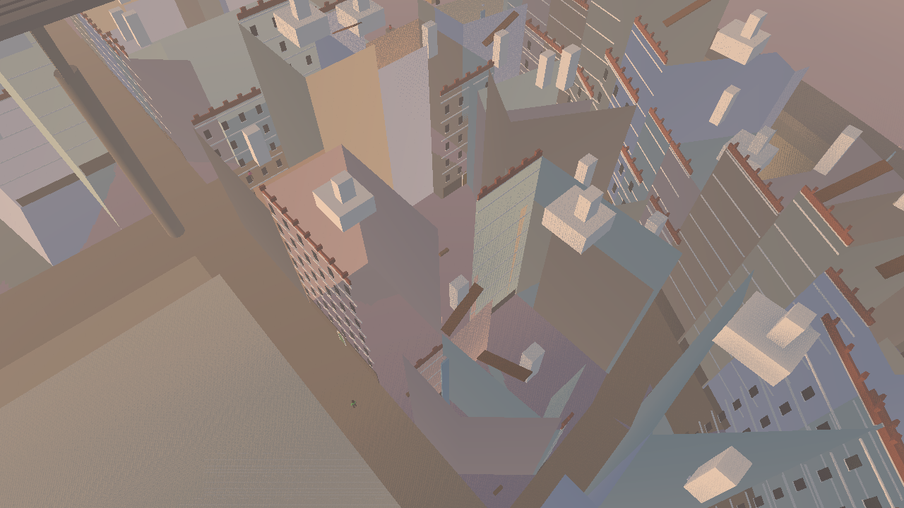
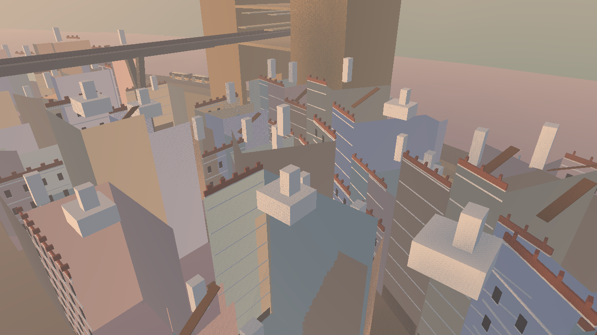

# Moy package P4 — build diagnostic (2026-10-19)

**Review state: not ready for L2 acceptance.** This build replaces the Old Moy massing shells with a first visible, collidable kit pass. It does not yet meet the binding 51-part / 10-join schedule. The missing items below are intentionally reported as gaps; no claim of completion is made. The locked city plan remains unchanged.

## What was built

- 99 P4 house owners are now represented: 60 Well Quarter, 30 Old Moy grid, and 9 numbered tower houses. The plan mix is 89 tower houses and 10 pencil infills (60-area split: 53 tower / 7 infill; grid: 27 / 3; numbered: 9 / 0). Runtime coverage confirms all 99 owners have collision; it does not certify their form against the schedule.
- Tower massing remains one continuous polygon blocker per house. Facade proxies add flat window panels, white horizontal courses, a painted door panel and mark, a front parapet strip, front merlons, a box wind shaft and optional manzar box. Earth bases do not yet have separate battered lifts or curved faces. The infill houses use tile-color panels and a lift-shaft box.
- Added 8 paved court floors with benches, 27 paved open pocket/yard floors with benches, 15 collidable roof-link ramps, and a collidable cylindrical first-well head. The yard walls and gate, passage cuts/lamps, pocket trees/pots, well lid/trough/ghaf, and shopfront operation are absent.
- P4 geometry is produced in `MoyCityBakeBuilder._old_moy_house` and `_add_old_moy_shared_spaces`; the saved bake contains 246 packs.

## Scheduled parts as built

The rows below follow `CityPlan.TOWER_HOUSE.parts` in plan order. “Proxy” means only an approximate visible or blocking cue exists; it does not mean the specified SuperEgg/SolidModel construction was completed.

| Part | Shape in plan | Status | Construction / gap |
|---|---|---|---|
| `plinth` | `profile` | missing | No profile course; polygon shell only. |
| `stone_wall` | `wall` | proxy | Continuous polygon shell via `_polygon_building`. |
| `ashlar_band` | `clipped` | missing | No clipped, mitred band. |
| `earth_lift` | `profile` | missing | No separate battered superellipse lifts. |
| `lift_horn` | `clipped` | missing | No turned-up lift ends. |
| `cornice` | `clipped` | missing | No square gypsum cornice. |
| `brick_wall` | `wall` | proxy | Same continuous shell as the base; no storey-separated brick wall. |
| `frieze` | `clipped` | proxy | Horizontal white box bands via `_add_old_face_box`; no scheduled pattern or mitre. |
| `latrine_shaft` | `clipped` | missing | No service shaft. |
| `drainpipe` | `egg` | missing | No drainpipe. |
| `mizab` | `clipped` | missing | No spout. |
| `light` | `punched` | missing | No punched base light. |
| `window` | `punched` | proxy | Flat dark facade panels via `_add_old_face_box`; no punched glass. |
| `surround` | `punched` | missing | No grown gypsum ring. |
| `qamariya` | `punched` | missing | No fanlight. |
| `sill` | `clipped` | proxy | A thin facade course below generic panels; not a seated sill. |
| `mafraj_window` | `punched` | missing | No top-floor low-wide opening. |
| `door_opening` | `punched` | missing | No punched opening; shell remains blocking. |
| `door_leaf` | `clipped` | proxy | Painted rectangular facade overlay via `_add_old_face_box`; shell remains closed. |
| `house_mark` | `decal` | proxy | Small painted square via `_add_old_face_box`, not a decal. |
| `shop_opening` | `punched` | missing | No shop opening or dressed shop bay. |
| `lintel` | `clipped` | missing | No timber lintel. |
| `shutter_leaf` | `clipped` | missing | No shutter set or split leaves. |
| `kishk` | `clipped` | missing | No box window. |
| `kishk_bracket` | `clipped` | missing | No bracket. |
| `lattice` | `decal` | missing | No lattice. |
| `parapet` | `wall` | proxy | Front-only parapet band via `_add_old_face_box`; not a perimeter wall. |
| `merlon` | `clipped` | proxy | Front-face solid boxes via `_add_building_box_part`; other faces omitted. |
| `horn` | `clipped` | missing | No corner horn. |
| `parapet_post` | `clipped` | missing | No ramp-gap post. |
| `roof` | `box` | proxy | Polygon shell top is collidable; no scheduled slab. |
| `kiosk` | `wall` | missing | No roof kiosk. |
| `kiosk_door` | `clipped` | missing | No kiosk door. |
| `wind_shaft` | `clipped` | proxy | Plain solid box via `_add_building_box_part`; no west mouth. |
| `wind_mouth` | `punched` | missing | No punched opening. |
| `wind_cap` | `clipped` | missing | No paired slabs or ridge cut. |
| `manzar` | `wall` | proxy | Plain box via `_add_building_box_part`; no wall openings. |
| `ramp` | `clipped` | proxy | Fifteen collidable `_box_body` ramps; not clipped flush at both roofs. |
| `ramp_rail` | `clipped` | missing | No side rail. |
| `passage_arch` | `punched` | missing | No passage cutter; houses are solid across the route. |
| `passage_lamp` | `egg` | missing | No passage lamp. |
| `bench` | `egg` | proxy | One simple `_box_body` bench per court and open pocket. |
| `bench_leg` | `clipped` | missing | No separate seated legs. |
| `pot` | `clipped` | missing | No pots. |
| `yard_wall` | `wall` | missing | Yard is paved/open; walls omitted. |
| `gate_post` | `clipped` | missing | No gateway posts. |
| `well_head` | `clipped` | proxy | Round collidable `_round_column` only. |
| `well_lid` | `clipped` | missing | No lid. |
| `trough` | `clipped` | missing | No trough. |
| `ghaf_trunk` | `clipped` | missing | No ghaf trunk. |
| `ghaf_crown` | `egg` | missing | No ghaf crown. |

## Scheduled joins as built

| Join | Kind | Status | Construction / gap |
|---|---|---|---|
| `floor_cut` | `seated` | proxy only | Static rectangular door overlay; no clipped egg, hinge, or opening. |
| `shutter_set` | `split` | missing | No four-piece shutter split. |
| `cap_ridge` | `meet` | missing | No two-part cap or shared ridge plane. |
| `band_chain` | `chain` | proxy only | Flat facade bars; no corner-bisector mitres. |
| `on_surface` | `placed` | partial proxy | Facade panels follow only one selected straight front edge; no curved surface fit or normal placement. |
| `lift_stack` | `chain` | missing | No stepped earth courses. |
| `ramp_ends` | `chain` | proxy only | Ramp blocks connect plan endpoints, but are not cut from a shared roof datum. |
| `seated` | `seated` | proxy only | Some boxes/cylinders stand on surfaces; no clipping/capping to seat planes. |
| `against_wall` | `seated` | proxy only | Flat overlay geometry; not clipped to the wall face. |
| `punched` | `punched` | missing | No scheduled Boolean or SolidModel openings. |

The brief’s close shots for the shut/open door pair, frieze mitre, cap ridge, seated merlon and punched window/glass/ring were not produced: those join constructions are absent. The six required district viewpoints are supplied below, but they are not substitutes for join evidence.

## Checks

| Check | Result |
|---|---|
| `python3 tools/city_layout.py` | Pass before build; plan checks emitted no failure list. The command rewrote generated `scripts/city_plan.gd`; it was restored from its verified clean pre-run version. |
| `tools/validate_city_plan.tscn` | Pass: 22 streets, 47 buildings, 133 lots, 0 failures. |
| `python3 tools/check_moy_bake.py` | Pass: 246 packs, current builder signature. |
| `tools/validate_moy_runtime.tscn` (Forward+) | Pass, 0 failures. P4 coverage: 99 house owners (89 tower / 10 infill), 99 collision bodies, 15 roof links, 8 courts, 27 open pocket floors, first-well head present. P3 coverage remains 80/80 market-house collision bodies. Pack-ready after 232 frames. |
| P0 Old Moy bounds `x −790…−637`, `z −210…210` | Completed with 1,008 findings: guard 591, overlap 204, reach 108, trap 96, solid 7, buried 2, underside 0. Not a passing suite. The Compatibility/dummy renderer logged invalid RID/mesh-bound errors before the checks, but completed and wrote the report. The 96 trap and 108 reach findings require inspection; the scan includes the surrounding city/terrain and are not isolated P4-only findings. |
| Parkour with human and Xiao Hou Zi | Not run: the brief’s five guided traversals require controlled in-game movement and were not proven by the static runtime audit. |

Full P0 report: [Markdown](checks/moy-2026-10-19-P4.md) · [raw JSON](checks/moy-2026-10-19-P4.json).

## Performance (P2 rendered probe)

Same existing P2 probe, Forward+, Apple M5 / Godot 4.7.1, 1280×720, seed 20261019, 5 s warmup and 30 s capture at each matched Crossroads/Old Moy viewpoint. Measurements are comparison only; city-wide optimization and final acceptance remain deferred until replacement districts are built.

| View | Before p95 ms | After p95 ms | Before peak draws / triangles | After peak draws / triangles |
|---|---:|---:|---:|---:|
| Crossroads spawn | 20.647 | 20.938 | 813 / 901,077 | 811 / 899,349 |
| Old Moy street | 30.664 | 34.705 | 2805 / 5,243,190 | 2894 / 5,334,618 |
| Old Moy rooftop | 32.365 | 34.014 | 2737 / 5,456,194 | 2841 / 5,544,508 |

After-run release evidence: both unload cycles failed to settle within 45 seconds; the P2 acceptance validator also reports incomplete required route samples/proofs and frame-budget failures. No final performance acceptance is claimed. The p95 reference is 33.3 ms; both Old Moy after samples exceed it. Raw runs: [before](raw/2026-10-19-moy-P2-p4-before.json) · [after final geometry](raw/2026-10-19-moy-P2-p4-after-final.json). An earlier intermediate after run (`p4-after.json`) was superseded after the nine numbered tower houses were wired into the bake.

## Screenshots

Rendered Forward+ at 1280×720 using the P4 atlas viewpoints, noon and dusk. The manifest records camera and renderer metadata: [shot-manifest.json](images/2026-10-19-P4/shot-manifest.json).

### Old Moy overview

### Well Quarter overview

### Cinema Square and first well

### Old High Street

### Reese–Miller court

### Old Moy roofs

## Differences from the brief and plan

- The data counts agree with the brief: 60 Well Quarter houses, 30 grid lots, and 9 numbered houses (99 total). Runtime confirms all owners and collision are present.
- The current schedule implementation does not match the plan’s part shapes, sizes, material palette, curved-earth placement, door/shop openings, feature distribution, or join planes. The table above lists every part and join.
- Courts/pockets are simplified; court passages remain blocked by continuous house shells, and the first well lacks its scheduled lid, trough, and tree. Roof ramps have colliders but are not flush-clipped at their ends.
- No plan data, footprint, street, station, or city-plan file was changed.

**Review requested:** decide whether to keep this as an explicitly partial prototype pass, or return it for a full scheduled-kit implementation before P4 can reach L2.
